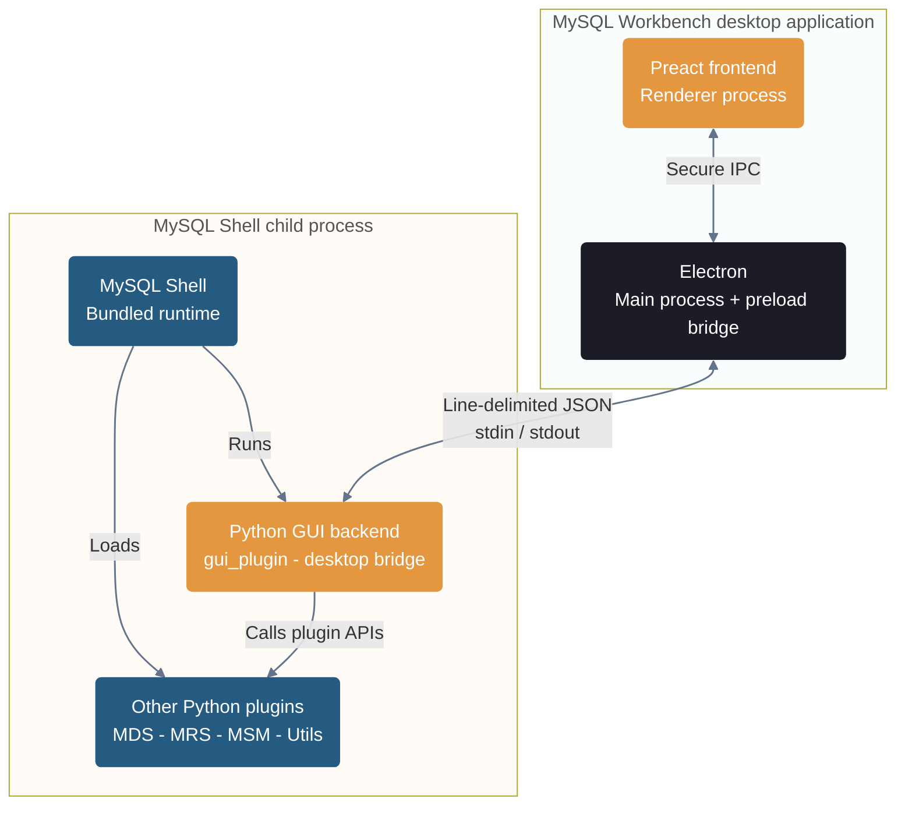
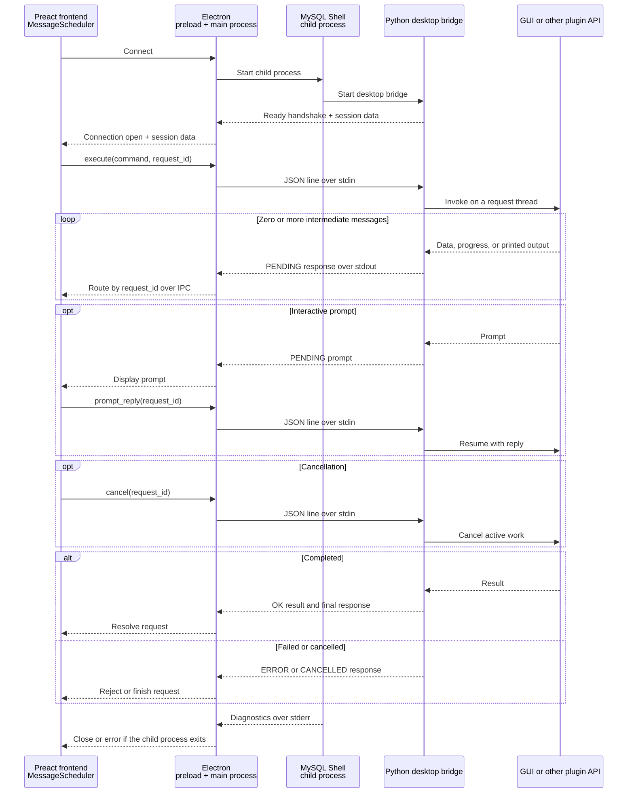

<!-- Copyright (c) 2026, Oracle and/or its affiliates.

This program is free software; you can redistribute it and/or modify
it under the terms of the GNU General Public License, version 2.0,
as published by the Free Software Foundation.

This program is designed to work with certain software (including
but not limited to OpenSSL) that is licensed under separate terms, as
designated in a particular file or component or in included license
documentation.  The authors of MySQL hereby grant you an additional
permission to link the program and your derivative works with the
separately licensed software that they have either included with
the program or referenced in the documentation.

This program is distributed in the hope that it will be useful,  but
WITHOUT ANY WARRANTY; without even the implied warranty of
MERCHANTABILITY or FITNESS FOR A PARTICULAR PURPOSE.  See
the GNU General Public License, version 2.0, for more details.

You should have received a copy of the GNU General Public License
along with this program; if not, write to the Free Software Foundation, Inc.,
51 Franklin St, Fifth Floor, Boston, MA 02110-1301 USA -->

# MySQL Workbench Developer Guide

## 1. Getting Started

The development launcher supports macOS and Linux on Arm64 and x64, and
Windows.

### Prerequisites

Install the following tools:

- Git.
- Node.js 22.12 or newer, including npm.
- A MySQL Shell archive or unpacked MySQL Shell tree for your platform. Use the
  latest version. An unpacked tree must contain `bin`, `lib`, and `share`
  directories.

A MySQL Server is not required to start Workbench, but you need one to open a
database connection.

### Get the source and install dependencies

Clone the repository and install the frontend and Electron dependencies:

```sh
git clone https://github.com/mysql/mysql-shell-plugins.git
cd mysql-shell-plugins

npm --prefix gui/frontend install
npm --prefix gui/electron install
```

### Prepare the MySQL Shell runtime

Choose one of the following ways to provide the MySQL Shell runtime.

#### To use a downloaded MySQL Shell archive

Download the compressed TAR or ZIP archive for your platform from the
[MySQL Shell download page](https://dev.mysql.com/downloads/shell/). Place it
under `gui/electron/packaging/mysql-shell` using one of these short names:

- `darwin-arm64.tar.gz` or `darwin-x64.tar.gz`
- `linux-arm64.tar.gz` or `linux-x64.tar.gz`
- `win32-x64.zip`

Prepare the development runtime from the archive:

```sh
cd gui/electron
npm run electron:dev:prepare
```

#### To use an unpacked or locally built MySQL Shell tree

Stage the tree directly:

```sh
cd gui/electron
bash ./scripts/package_desktop.sh --dev \
    --mysqlsh-tree=/path/to/mysql-shell-tree
```

Both methods create a development runtime under
`gui/electron/packaging/mysql-shell-dev-staging`, with links to the plugin
sources in this checkout.

### Install the backend requirements

From the repository root, install the backend Python requirements into the
prepared MySQL Shell runtime. Use its `mysqlsh` binary, or the same MySQL Shell
version from `PATH`:

```sh
mysqlsh --pym pip install -r gui/backend/requirements.txt
```

### Start Workbench with Vite

After preparing the runtime, start the development environment without staging
it again:

```sh
cd gui/electron
bash ./scripts/run_electron_dev.sh
```

On Windows, use:

```sh
ELECTRON_MYSQLSH_PLATFORM=win32-x64 bash ./scripts/run_electron_dev.sh
```

The script starts Vite for the frontend, launches Electron, and connects it to
the staged MySQL Shell runtime. Frontend changes reload automatically; Electron
and backend changes require restarting Workbench.

## 2. Debugging Tips

### Logs

Workbench stores its logs under its user data directory:

- macOS: `~/Library/Application Support/MySQL Workbench`
- Linux: `$XDG_CONFIG_HOME/MySQL Workbench`, or
  `~/.config/MySQL Workbench` when `XDG_CONFIG_HOME` is not set.
- Windows: `%APPDATA%\MySQL Workbench`

| Log | Location | Contents |
|---|---|---|
| Vite | Terminal running `run_electron_dev.sh` | Frontend build and hot-reload messages. |
| Electron and renderer | `<userData>/MySQL Workbench-electron.log` | Startup, renderer console output, blocked IPC or navigation, and process failures. |
| MySQL Shell and Python backend | `<userData>/mysqlsh/mysqlsh.log` | Shell and backend diagnostics. Open it from **Developer > Open mysqlsh.log File**. |
| Protocol trace | `<userData>/mysqlsh/plugin_data/gui_plugin/mysqlsh_gui_backend_log.sqlite3` | Requests, intermediate messages, and responses. Written only when `MYSQL_SHELL_GUI_DEBUG_MODE=1` is set before launch. |

Pass additional command-line options to the MySQL Shell child process through
`MYSQLSH_GUI_EXTRA_ARGS`. For example, to increase the log level and include
executed SQL in `mysqlsh.log`:

```sh
MYSQLSH_GUI_EXTRA_ARGS="--log-level=debug --log-sql=all" \
    bash ./scripts/run_electron_dev.sh
```

Enable and follow the protocol trace with:

```sh
# Terminal 1
MYSQL_SHELL_GUI_DEBUG_MODE=1 bash ./scripts/run_electron_dev.sh

# Terminal 2
MYSQLSH_USER_CONFIG_HOME="<userData>/mysqlsh" \
    python3 gui/tools/logtail.py --pretty
```

## 3. Architecture

Workbench is split between the Electron desktop application and a bundled
MySQL Shell child process.

| Component | Source | Responsibility |
|---|---|---|
| Preact frontend | `gui/frontend` | Renders the interface and schedules backend requests. |
| Electron host | `gui/electron` | Manages windows, native desktop features, and child processes. |
| GUI backend | `gui/backend/gui_plugin` | Implements Workbench operations and the desktop communication bridge. |
| MySQL Shell | Staged under `gui/electron/packaging` | Hosts the Python backend, plugin APIs, and database sessions. |
| Other plugins | `mds_plugin`, `mrs_plugin`, `msm_plugin`, `util_plugin` | Provide cloud, REST service, schema management, and utility features. |

The following diagram shows the major components in MySQL Workbench and their
interaction:



### UI structure

The Workbench UI is organized into workspaces. A connection workspace is the
top-level page for one saved MySQL connection and owns the documents opened for
it, including SQL scripts, notebooks, and administration pages. Those views
share a connection data model and backend module session rather than opening an
unrelated connection for every tab.

A normal online connection workspace asks its backend module session to open
two sessions, a service session followed by a user session:

- The **user session** executes SQL from the editor and owns user-visible state
  such as the current schema and transaction. Workbench does not use this
  session for its own internal queries.
- The **service session** performs metadata, administration, and background
  work and is not exposed for user queries.

Two separate sessions are used in order to maintain their state isolated and
predictable.

Both sessions are created under the workspace's backend module session and are
closed with the workspace. Service-only and offline workflows do not
necessarily open both.

### Backend to Frontend Transport

The desktop transport is a long-lived, line-delimited JSON channel rather than
a series of independent calls. It supports startup and session events,
concurrent requests, intermediate results, prompts, cancellation, and terminal
responses.



Every request has a `request_id`, allowing multiple operations to be in flight
at once. Electron uses that ID to return responses to the window that started
the request. Messages without a request ID, such as session state, are broadcast
to the registered Workbench windows. A request can produce multiple `PENDING`
messages before ending with `OK`, `ERROR`, or `CANCELLED`.

### Security boundary

The renderer runs with context isolation enabled and without direct Node.js or
Electron access. The preload bridge exposes only the desktop operations it
needs. Standard output from MySQL Shell is reserved for protocol messages, while
backend diagnostics go to standard error.

## 4. Development Notes

Use the Vite launch described in [Getting Started](#start-workbench-with-vite)
for normal development. The staged MySQL Shell runtime links back to the plugin
sources in this checkout, so it does not need to be rebuilt after source edits.
See the [Electron build notes](electron/developer.md) for desktop packaging,
distributable artifacts, and Electron end-to-end tests.

### Edit and reload

| Changed code | What to do |
|---|---|
| Preact frontend under `gui/frontend/src` | Save the file; Vite rebuilds and reloads the renderer. |
| Electron code under `gui/electron/src` | Restart Workbench. |
| Python backend or another plugin | Restart Workbench so the MySQL Shell child process reloads the plugin. |

Use the **Developer** menu in Workbench to open Chromium DevTools, toggle the
communication debugger, or open the `mysqlsh.log` file.

### Frontend and backend APIs

The frontend sends backend calls through `ShellInterface` and
`MessageScheduler`. Follow this workflow when adding a backend function:

1. Add the function to a suitable Python plugin and decorate it with
   `@plugin_function("gui.<module>.<function>", web=True)`. Use Python type
   annotations, document every argument and return value, and validate inputs at
   the API boundary. If you create a module, import and register it from the
   plugin's `init.py`.
2. Regenerate the TypeScript protocol definitions with MySQL Shell available on
   `PATH`:

   ```sh
   cd gui/tools
   npm run update-protocols-file
   ```

3. Check the generated `Protocol<Plugin>.ts` diff, then add a method to the
   nearest `gui/frontend/src/supplement/ShellInterface` class. Send the request
   through `MessageScheduler` using the generated `ShellAPI<Plugin>` member and
   parameter types; do not construct protocol command names by hand.
4. Restart Workbench so MySQL Shell registers the new function, then exercise
   it with the communication debugger open and add backend and frontend tests.

Use camelCase for public keys inside option dictionaries. If nested keys must
retain their original casing during transport, include the dictionary parameter
in `caseConversionIgnores`, for example `caseConversionIgnores: ["options"]`.

Run protocol generation whenever a web function is added or removed, or its
signature, type annotations, or docstring changes. Do not edit generated
`gui/frontend/src/communication/Protocol<Plugin>.ts` files directly.

## 5. Contributing Patches

Before submitting a patch, read the repository's
[contribution guide](../CONTRIBUTING.md). It covers the Oracle Contributor
Agreement, signed-off commits, tests, and the pull request process.

Use the [MySQL Shell Plugins repository on GitHub](https://github.com/mysql/mysql-shell-plugins)
to open an issue, fork the project, and submit a pull request. For questions or
early discussion, join the [MySQL Community Slack](https://mysqlcommunity.slack.com/)
and use the `#workbench` channel.

Copyright &copy; 2026, Oracle and/or its affiliates.
